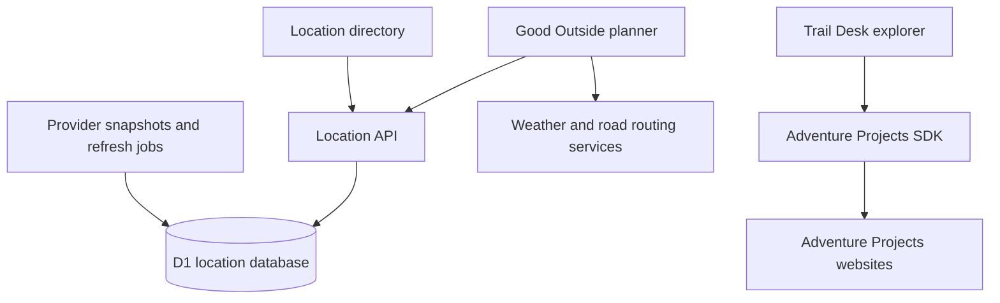

# Architecture

## Current runtime boundaries

Good Outside owns its API, D1 schema, ingestion, health and MCP refresh endpoints. Planner and directory are two views of this app, not separate services. Its frontend lives in public/; backend/ contains ingestion, database normalization, API and jobs; db/ and drizzle/ contain schema/migrations. Keeping these together preserves tested relative imports and deployment behavior.

Trail Desk owns its UI and a Worker adapter. It has no persistent location DB. Its vendor copy of the SDK is synchronized from packages/adventure-projects-client by explicit root commands. This preserves standalone deployment archives while establishing a canonical implementation. Shared UI is not yet extracted: the apps have different interfaces and starter components.

The API SDK is independently usable with no runtime dependencies. Its demo remains inside the package as a reference integration. Each full-stack app retains its own lockfile and Cloudflare/Vinext configuration. The root package supplies commands without dependency hoisting or an unverified lockfile migration.

## Future integration sequence

1. Use Good Outside as the main navigation shell, with planner and location directory entry points. Link to Trail Desk as an advanced data explorer; consolidated navigation is not implemented in this restructuring.
2. Add an explicit Adventure Projects adapter using the SDK. Preserve provider ID, original route ID, provenance, geometry type and source rights; do not silently import undocumented upstream content wholesale.
3. Define cross-provider matching separately from source identity. Nearby points must not be assumed to describe the same trailhead or destination. Retain source records even when associated with a canonical place.
4. Once adapter contracts are stable, extract reusable catalog types/normalization into a separate package. Do not move Worker-specific DB/jobs into the browser bundle.
5. Decide whether to serve the explorer under the planner domain or keep independent deployments. Implement shared navigation/auth only after that choice; existing account-specific auth infrastructure is not portable automatically.

## Data boundary

Snapshots are stored outside GitHub in R2. `npm run data:download` verifies a versioned checksum manifest and restores exact JSON under apps/good-outside/data, where ingestion scripts expect it. A data manifest preserves source counts, timestamps and license metadata. These snapshots rebuild location content, not original hosted refresh-job state. Browser-local bookmarks are not exported.
